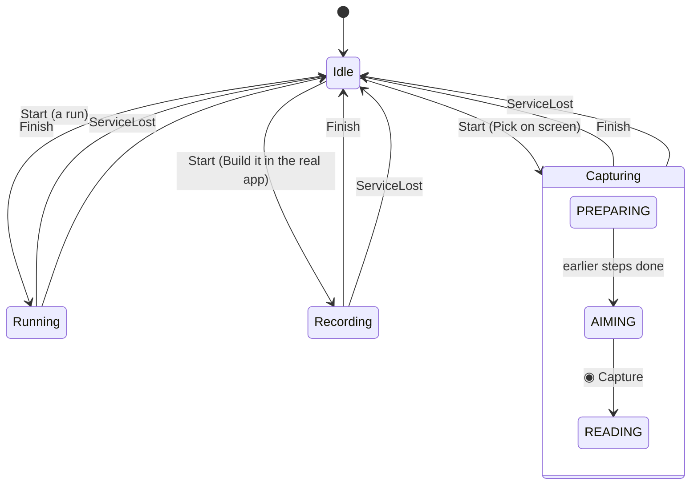
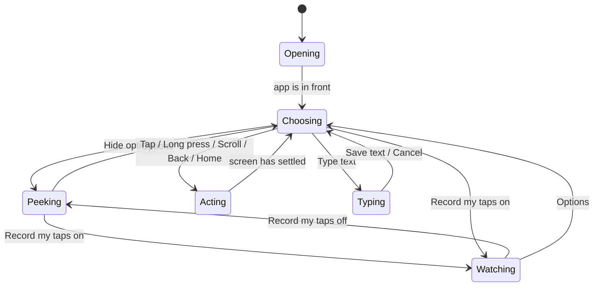

# State machines in TaskPilot

A *state machine* is anything that is "in one of a few situations, and moves between them".
An *implicit* one is where the situation is never written down — it has to be worked out from a
handful of booleans, nullable fields, strings and timestamps, and some combinations of those
should never happen but nothing stops them.

Version 1.4.0 went through the whole app looking for these. This file is the result: what was
found, what was made explicit, what was deliberately left alone, and the rules for changing them.

**The pattern used everywhere it was worth it**

* The states are a `sealed interface` / `enum` in `app/src/main/java/com/taskpilot/app/core/`.
* The rules are a pure function there — *(state, event) → next state (+ things to do)* — with no
  Android imports, so every transition has a unit test that runs on a plain JVM in seconds
  (`app/src/test/…/core/`, run by the cloud build).
* The Android side (`engine/`, `ui/`) only feeds events in and carries effects out.
* Every state change is logged by name to `core/Trace` → History → **Copy report**.

---

## 1. Who is using the screen — `Engine.mode`

`core/EngineMode.kt` (rules + `EngineRulesTest`), `engine/Engine.kt` (the one holder).

*Before:* spread over `Runner.job`, `Runner.state`, `CaptureStore.waiting`, `Recorder.session`, and
a `setActive(Boolean)` on the accessibility service that seven places called — last caller won.
A capture finishing during a scheduled run switched the service to its idle setting mid-run; a
scheduled run could start on top of a capture.

*Now:* nothing starts unless the engine is `Idle` (the refusal carries the reason shown to the
user), only the owner can update or finish, and the service's idle/active setting is derived from
the mode in exactly one place (`Engine.send`). Losing the accessibility service ends whatever was
going on.

**Rule:** anything that wants the screen calls `Engine.start(mode)` first and `Engine.finish(owner)`
when done. Never call `AutomationService.setActive` yourself.

## 2. How a run ended — `RunStatus`, `StepStatus`, `Trigger`

`core/Status.kt` (`StatusTest`, `SavedFilesTest`).

*Before:* strings — `"success" | "failed" | "stopped"`, `"ok" | "failed" | "skipped"`,
`"Scheduled" | "Manual" | "Capture"`, `""` for "never run" — compared with `==` across the engine and the screens.

*Now:* enums, saved with the **same words** (old files load unchanged; an unknown word from a newer
version falls back instead of failing). `when` over them is checked by the compiler.
New: `RunStatus.SKIPPED` — a scheduled run that could not start now always leaves a History entry
and a notification (before, two of the three reasons left only a notification).

## 3. The recorder ("Build it in the real app") — `RecState`

`core/RecorderMachine.kt` (`RecorderMachineTest`, 40 tests), `engine/Recorder.kt`, `ui/RecorderOverlay.kt`.

*Before:* `session?` × `panelOpen` × `liveRecord` × `typingInto?` × `busy` × `confirmCancel` ×
`pendingText?` × `ignoreEventsUntil` — separate variables, kept consistent by hand in each function.
Found while untangling: "Discard" stayed armed forever (tap it once, work ten minutes, brush it
again → everything gone); `busy` could stick after closing.

*Now:* one `RecState` with exactly one `RecMode`; `RecorderMachine.reduce(state, event)` returns the
next state and the effects (`Perform`, `Focus`, `PressKey`, `ReadScreen`, `Commit`, `Abandon`).
The overlay draws the state and sends events; the panel window exists exactly while the mode is
`Choosing`. Passwords can't be recorded in any mode (tested).

## 4. Following the other app's screen — `ScreenWatch` (new in 1.4.0)

`core/ScreenWatch.kt` (`ScreenWatchTest`).

`Clean → Dirty (the app changed) → Reading (once it has been quiet 0.45 s, or 2.5 s at most) → Clean`,
and `Dirty` again if the app changed during the read. While the options panel is open a 4 s
heartbeat catches apps that change without telling Android.

This is what makes the options list move on by itself after choosing an app, after every action,
and while the user navigates by hand — it replaced two fixed waits (1.8 s after opening, 1.3 s
after each action) and the ↻ button.

## 5. "Pick on screen" — `Capture` + `CaptureOutcome`

`engine/Capture.kt`, `core/Flows.kt`. Phases live in `Engine.mode` (see the diagram in §1).

*Before:* `captureAsk` + `expectingCapture` in the step editor, `CaptureStore.waiting/result`, a
pill view in the service and an `after` lambda threaded through `Runner.launch`. Cancelling on the
pill left `expectingCapture` set; if "run the earlier steps first" failed, the user was left in the
other app with no message.

*Now:* every ending is a `CaptureOutcome` (`Ready` / `Failed(reason)` / `Cancelled`) addressed to the
step that asked, and every ending brings TaskPilot back to the front.

## 6. Pressing Send in WhatsApp — `SendFlow`

`core/SendFlow.kt` (`SendFlowTest`), used by `AutomationService.sendAndConfirm`.

The loop's counters (`clicks`, `lastClick`, `composerPressed`, `quietChecks`) are now a value with
two functions, `decide(now, look)` and `pressed(now, target, ok)`. The rules that produced the
voice-note bug of 1.1.2 are pinned by tests: the chat's round button is pressed at most once and
only with a caption; nothing is pressed once the files are in the chat; four presses at most.
Behaviour is unchanged from 1.1.3.

## 7. "Wait for new files" — `FilesWatch`

`core/FilesWatch.kt` (`FilesWatchTest`), used by `StepExec.waitNewFiles`.

`Waiting → Growing → Ready`, or `Ended (script crashed / finished, no files) → 12 s grace → ScriptEnded`,
or `TimedOut`. Tested against the real traceback from 29 Oct 2026. Behaviour is unchanged.

## 8. Installing an update — `UpdateState`

`core/Flows.kt`, `engine/Updater.kt`.
`Idle → NeedsPermission | Preparing → Confirming → (app restarts)`, or `→ Failed(reason)`.

*Before:* `busy` + `status` text inside the Setup card; Android's answer arrives in a broadcast
receiver that could not reach them, so after a failed install the card kept saying
"Android will now ask you…".

## 9. The accessibility service — `A11yState`

`OFF`, `ON_NOT_RUNNING`, `READY`. The middle one — switched on in Android's settings but stopped by
the phone — used to count as "on": Setup showed a green tick while every run failed with "service
is off". It now has its own warning on Home and in Setup (after a 2.5 s grace, because right after
the app starts Android may still be connecting the service).

## 10. Dialogs on a screen — `HomeDialog`, `EditorDialog`, `StepDialog`

Each screen had 2–5 independent "is this dialog open" flags (and the step editor a `picker` +
`pickerKey` pair). Each is now one nullable sealed value: at most one dialog, and hand-offs
("Add a step" sheet → "Build it in the real app" → app picker) are a single assignment.

## 11. Loading saved files — `Repo.loadProblem`

*Before:* "the file could not be read" looked exactly like "nothing saved yet": an empty list —
which the next save wrote over the real file. *Now:* an unreadable file is first copied aside
(`workflows.json.unreadable-<time>`), and Home says so.

---

## Looked at and deliberately left alone

| Where | What it is | Why it stays as it is |
|---|---|---|
| `ui/AppRoot.kt` | Navigation stack | Already explicit: a sealed `Screen` and a saved stack. |
| `Schedule` | off / on-but-no-days / armed | Fully derived by `Scheduler.nextTrigger`; the UI already shows all three. |
| `StepExec.openFile`, `tapElement`, `wakeUnlock`, `sendEmail` | do → check → retry once → report | Straight-line procedures. Top-to-bottom code *is* the clearest picture of a straight line; a state type would only add words. |
| Step editor draft | new / clean / changed | Derived from `draft != original`. |
| PIN | saved / not saved, and each step's "use it" switch | Two real booleans; the run reports the one bad combination clearly. |
| Setup checklist | 5 permissions | Read from Android each time the screen resumes — there is no state of ours to keep. |
| `Runner` wake lock, `WakeActivity` | acquire → release | `try/finally` and the activity lifecycle already guarantee the pairing. |
| `CodeEdit.splitValue` | in-quotes / out-of-quotes while scanning a line | A local lexer; covered by the CodeEdit tests of 1.2.0. |
| Menus, single confirm dialogs, `PinSection`, element picker tab | one boolean each | A boolean is a correct two-state machine. |

---

## Changing a state machine — checklist

1. Change the type and the rule in `core/` first. The compiler will point at every `when` that
   needs a new branch.
2. Add or adjust the test next to it. A new transition without a test is not done.
3. Only then touch `engine/` or `ui/`. If you find yourself adding a `var … = false` to remember
   "what is going on", it belongs in the state type instead.
4. Saved words (`RunStatus.wire` etc.) are forever — add new ones, never rename.
5. `core/` must not import `android.*` / `androidx.*` (the cloud build checks).
